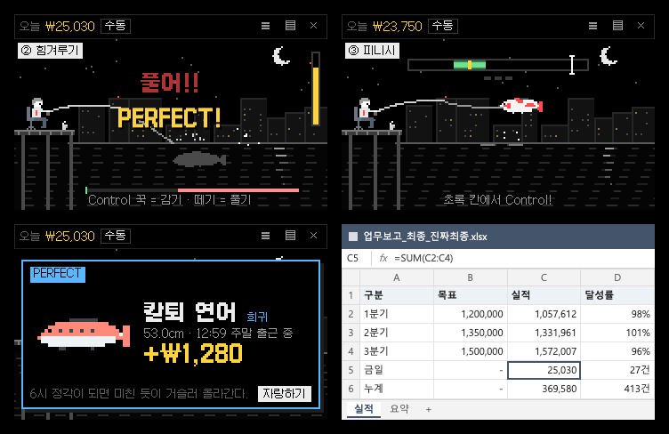

# 🎣 월급루팡 낚시터

일하는 척하면서 **화면 구석에서 낚시하는** 검정 도트 게임.
모니터 위에 늘 맨 위로 떠 있는 작은 낚시터 창에서, 엑셀을 켜 놓은 채로 **Ctrl 키만 눌러** 물고기를 낚아요.
낚시터는 **투명**해서 뒤 화면이 비치고 낚시꾼·찌·물고기만 보여요 (원래의 밤 연못 **풍경** 모양으로도 바꿀 수 있어요).
잡은 물고기는 크기·희귀도대로 바로 팔려서 **오늘 수익**에 쌓이고(자정에 0부터), 누적 수익으로 인턴 → … → 전설의 월급루팡까지 직급이 올라요.
덤으로 화면에 붙여 두는 **스티커 메모**도 있어요 — 단축키 한 번에 새 메모, 지운 메모는 앱 안 휴지통에서 되살리기.

## 다운로드

- 맥 13 이상 (애플 실리콘·인텔): [LupinFishing-mac.dmg](https://github.com/kanchoooo/lupin-fishing/releases/latest/download/LupinFishing-mac.dmg)
- 윈도우 10/11: [LupinFishing-Setup.exe](https://github.com/kanchoooo/lupin-fishing/releases/latest/download/LupinFishing-Setup.exe) — "Windows의 PC 보호" 창이 뜨면 **추가 정보 → 실행**
- 다운로드 페이지: https://kanchoooo.github.io/lupin-fishing/



- 낚시터 창은 물·낚시꾼·위쪽 막대를 잡고 끌어서 화면 어디로든 옮기고, 물 위 **▼(낚시 자리)** 는 끌어서 던질 자리를 정함
- 투명 모양: 바탕·테두리 없이 낚시꾼·찌·물결 선·게이지·오늘 금액만. 평소엔 흐리게(진하기 설정), 마우스를 올리거나 낚는 중엔 또렷하게, 버튼은 마우스를 올리면. 빈 하늘을 누르면 클릭이 뒤 창으로 지나감 (`setIgnoreMouseEvents` + 메인이 커서 위치를 30Hz 로 알려 줌)
- 투명 모양 선·글자 색: 자동(컴퓨터가 다크 모드면 흰색, 아니면 검정) · 검정 · 흰색. 풍경용 회색을 밝기 뒤집어 검은 선으로 바꿔 그림 (`scene.ts` 의 `inkPixels`)
- 맥 / 윈도우 (Electron 44 + TypeScript + React)
- 그림: 이미지 파일 없이 도트 문자열로 그림 (`src/renderer/src/art/sprites.ts`, 장면은 `widget/scene.ts`)
- 효과음: WebAudio 8비트 합성 (`src/renderer/src/common/sound.ts`)
- 다른 앱 쓰는 중에도 키 받기: [koffi](https://koffi.dev) FFI 로 키 상태를 60Hz 로 읽음 (`src/main/keys.ts`) — 키 입력을 가로채지 않아서 다른 앱에도 그대로 간다

## 실행

```bash
npm install
node scripts/fetch-koffi.mjs   # 맥 x64/arm64 · 윈도우용 koffi 네이티브 모듈 (패키징 때만 필요)
npm run dev                    # 개발 모드
```

창을 닫아도(×) 메뉴 막대(맥) / 작업 표시줄 트레이(윈도우)의 찌 아이콘으로 계속 실행돼요. 완전히 끄려면 트레이 메뉴 → 종료.

## 놀이

| 단계 | 하는 일 |
|---|---|
| 낚시 자리 | 물 위의 **▼** 를 끌어서 옮김 (설정에 저장). 멀수록 희귀한 물고기가 조금 더, 대신 오래 기다림 |
| 던지기 | 낚싯대 키 **꾹** → 떼면 던짐. 힘 막대가 오르내림 — 꽉 채울수록 ▼ 자리에 정확히 떨어짐 |
| 기다리기 | 찌가 톡톡(입질 흉내) — 이때 당기면 **헛챔질**. 찌를 끌어서 다른 자리로 옮길 수도 있음 (물고기가 놀라 조금 더 기다림) |
| ① 입질 | 찌가 쑥 + `!` → 바로 누르기. 0.25초 안이면 **PERFECT** (힘겨루기 유리하게 시작) |
| ② 힘겨루기 | 꾹 = 감기, 떼기 = 풀기. 오른쪽 **장력 막대**·아래 **거리 막대**. 물고기가 물보라(`온다!`) 뒤 확 당기면(`풀어!!`) 놓기. 장력이 끝까지 차면 줄이 끊어지고, 너무 느슨하면 바늘이 빠지고, 너무 오래 풀면 도망 |
| ③ 피니시 | 물고기가 튀어 오르면 커서가 **초록 칸**에 올 때 누르기. 희귀 2번 · 영웅 2번 · 전설 3번. 한가운데면 PERFECT(값 ×1.2). 두 번 놓치면 도망 |

- **자동 낚시**: 알아서 던지고 낚지만 성공률이 낮음 (흔함 40% · 보통 30% · 희귀 15% · 영웅 5%, 전설은 0% — "전설은 손맛으로만!"). 입질 때 키를 누르면 그 물고기는 직접 잡음
- 손맛 숫자는 `src/renderer/src/widget/game.ts` 의 `TUNE`. 사람 흉내 봇으로 맞춘 값 (반응 0.18초 봇: 전설까지 거의 다 잡음 / 0.28초 봇: 흔함 96% · 희귀 84% · 영웅 48% · 전설 5%)

### 키

- 기본 낚싯대 키: **왼쪽 Ctrl(맥은 Control)** — 일하는 중에 혼자 눌려도 다른 앱에서 아무 일도 안 생기는 키
- 위장 키: 맥 **오른쪽 Option** / 윈도우는 없음(설정에서 지정). ESC · ▤ 버튼도 됨
- 단축키 (조합 키, 설정에서 바꿈 · 다른 앱 쓰는 중에도): **Ctrl+Alt+N**(맥 ⌃⌥N) 새 스티커 메모 · **Ctrl+Alt+L**(맥 ⌃⌥L) 투명 ↔ 풍경. Electron `globalShortcut` — 다른 앱이 이미 쓰는 조합이면 설정에 경고
- 설정에서 **아무 키나** 지정 가능 (키보드 아무 키 · 마우스 휠 클릭 · 마우스 옆 버튼). 낚시터를 **클릭·꾹 누르기**로도 낚시
- 다른 앱 쓰는 중에도 받기
  - 윈도우: 모든 키 (`GetAsyncKeyState`, 권한 필요 없음)
  - 맥: 보조 키(Control·Option·Command·Shift)·마우스 버튼은 권한 없이 (`CGEventSourceFlagsState`, `NSEvent.pressedMouseButtons`), 그 밖의 키는 `CGEventSourceKeyState` — "입력 모니터링" 권한이 필요할 수 있어 설정에 허용 버튼이 있음
  - 설정의 **키 테스트**로 다른 창을 쓰는 중에 잡히는지 바로 확인
- 윈도우 기본 키로 Shift·오른쪽 Alt·오른쪽 Ctrl 을 피한 이유: Shift 5번 = 고정 키 창, 한국어 자판의 오른쪽 Alt = 한/영, 오른쪽 Ctrl = 한자

### 바이럴 장치

| 장치 | 내용 |
|---|---|
| 위장 화면 | 낚시터가 평범한 노란 스티커 메모로 변신 — 진짜로 글을 쓸 수 있고 저장됨 (메모의 × · ESC 로 복귀) |
| 잡은 시간 꼬리표 | `14:32 식곤증 타임에 포획` · 점심시간 · 퇴근 직전 · 칼퇴 실패 · 야근 중 · 주말 출근 중 … |
| 루팡 직급 | 누적 수익: 인턴 → 사원 → 주임 → 대리 → 과장 → 차장 → 부장 → 이사 → 사장 → 회장 → 전설의 월급루팡 |
| 시급 환산 | "시급 10,320원(2026 최저시급) 기준 3시간 12분어치" — 시급은 설정에서 바꿈 |
| 오늘의 시세 | 날짜마다 한 종이 판매가 ×2 |
| 자랑 이미지 (1080×1350) | 잡은 물고기 카드 · 오늘의 루팡 리포트 · 도감. 카드를 먼저 크게 보여 주고 **공유하기**(맥: 공유 메뉴 + 클립보드 / 윈도우: 클립보드 → 붙여넣기) · **이미지 저장** (`src/renderer/src/common/share.ts`, `panel/useShare.tsx`) |
| 물고기 | 50종 (물고기 44 · 잡동사니 6) — 회식 메기 · 칼퇴 연어 · 월요병 광어 · 연차 고등어 · 점심 메뉴 우럭 · 멘탈 개복치 · 영업왕 아귀 · 퇴사 잉어 · 만년 과장 실러캔스 · 연봉협상 고래(엄청 작음) … (`src/shared/fish.ts`) |

패널 아래에는 늘 **인스타그램 보기**(@easyticket.co.kr) · **개발자의 다른 앱 보기** 버튼과 "팔로우하면 새로 나온 재밌는 앱을 바로바로 해볼 수 있어요" 안내가 있어요 (트레이 메뉴에도).

### 스티커 메모

- 단축키(기본 Ctrl+Alt+N · 맥 ⌃⌥N) · 트레이 메뉴 · 패널 메모 탭 · 메모의 + 로 새 메모. 마우스 근처에 떠서 바로 쓸 수 있음
- 화면 아무 데나 여러 장 붙여 두고 끌어서 옮기기 · 모서리로 크기 · 색 7가지 · 📌 항상 맨 위 · − 치우기(메모 탭·트레이 "메모 모두 보기"로 다시)
- 🗑 지우기 → **앱 안 휴지통** (메모 탭에서 내용 확인 · 되살리기 · 영구 삭제 · 비우기). 빈 메모는 그냥 사라짐
- 저장: `userData/memos.json` (`src/main/memos.ts`), 창은 `memo.html#메모id`

### 수익 기록

- 오늘 수익: 내 컴퓨터 날짜 기준, 자정에 0부터 (`src/shared/day.ts` 의 `dayKey`)
- 누적 수익 · 날짜별 수익(최근 14일 막대 + 전체 목록, 날마다 리포트 자랑) · 최근에 잡은 것 (가장 비싼 한 마리는 👑 로 크게, 최신순/비싼순)
- 값: 흔한 물고기 몇백~2천 원 · 보통 6천~1만 · 희귀 2~3만 · 영웅 10~18만 · 전설 60만~250만 (잡동사니는 싸게). 크기가 클수록 비쌈
- 0.2.0 에서 값을 올리면서 직급 기준도 10배로 올렸고, 예전 기록은 처음 켤 때 10배로 맞춰 직급이 그대로 (`store.ts` 의 `migratePrices`)
- 저장: `userData/state.json` (`src/main/store.ts`)

## 구조

```
src/main/
  index.ts     앱 · 낚시터 창(항상 위, 테두리 없음, 끌어 옮기기) · 패널 창 · 트레이 · IPC
  keys.ts      전역 키 읽기 (윈도우 user32 / 맥 CoreGraphics·AppKit) + 맥 입력 모니터링 권한
  store.ts     설정 · 도감 · 날짜별 수익 (userData/state.json)
  memos.ts     스티커 메모 창 · 휴지통 (userData/memos.json)
src/shared/    물고기 · 키 이름 · 단축키 · 메모 색 · 날짜·직급 · 타입
src/renderer/src/
  widget/      낚시터: game(상태 머신) · scene(도트 장면, 투명/풍경) · Widget(입력·화면) · Sticky(위장 메모)
  panel/       도감 · 수익 · 메모 · 설정 · 정보 · 자랑 카드 미리 보기
  memo/        스티커 메모 창
  art/         물고기 도트 · 그리기
  common/      효과음 · 자랑 이미지 · 공용 CSS
  lab/         그림 확인용 (앱에는 안 들어감)
```

## 테스트 (헤드리스)

```bash
npm run build
# 단계별 장면 한 장에 (scenes = 풍경 · clear / clear-dark = 투명 모양)
LUPIN_HEADLESS=1 LUPIN_LAB=scenes LUPIN_SIZE=760x900 LUPIN_SHOT=scenes.png npx electron .
LUPIN_HEADLESS=1 LUPIN_LAB=clear LUPIN_SIZE=760x900 LUPIN_SHOT=clear.png npx electron .        # 흰 문서 위 검은 선
LUPIN_HEADLESS=1 LUPIN_LAB=clear-dark LUPIN_SIZE=760x900 LUPIN_SHOT=clear-dark.png npx electron . # 어두운 화면 위 흰 선
# 앱 아이콘 다시 만들기
LUPIN_HEADLESS=1 LUPIN_LAB=icon LUPIN_SIZE=1024x1024 LUPIN_SHOT=build/icon.png npx electron .
# 시나리오: 낚시터·패널을 조작하고 캡처 (shots/)
LUPIN_HEADLESS=1 LUPIN_SCRIPT=test.json npx electron .
#  test.json 예: [{"at":1500,"widget":"__game.debugSet('fight','tuna')"},{"at":2000,"shot":"fight"},
#                 {"at":2200,"openPanel":"money"},{"at":3500,"panelShot":"money"},
#                 {"at":3700,"newMemo":true},{"at":4700,"memoShot":"memo"},{"at":4800,"quit":true}]
LUPIN_SELFTEST=1 dist/mac-universal/LupinFishing.app/Contents/MacOS/LupinFishing   # 패키징된 앱에서 koffi 확인
```

환경변수 목록은 `src/main/env.ts`.

## 빌드·배포

| 명령 | 결과 |
|---|---|
| `npm run dist:mac` | 맥 유니버설 dmg + zip, Developer ID 서명 + 공증 (`dist/LupinFishing-mac.dmg`) |
| `npm run dist:mac:local` | 서명 없이 내 맥용 .app |
| `npm run dist:win` | 윈도우 설치 파일 (맥에서도 빌드됨, 서명 없음) |
| `npm run release` | 버전 올리고 GitHub Releases 에 맥·윈도우 올려 공개 (자동 업데이트) |

- 맥 서명·공증은 **미니미 광장·비둘기 모니터와 같은 인증서**(`~/.minimi-signing/`)와 공증 프로필(`minimi-notary`)을 씁니다.
  `scripts/build-mac.mjs` 는 같은 잠금(`~/.minimi-signing/.build.lock`)을 써서 서명 빌드가 동시에 돌지 않고,
  임시 키체인(`lupin-build.keychain-db`)은 검색 목록 맨 뒤에만 붙였다가 끝나면(실패·Ctrl+C 포함) 빼고 지웁니다.
- 윈도우는 서명 없이 배포 → 설치할 때 "Windows의 PC 보호" → **추가 정보 → 실행**.
  태그가 올라가면 `.github/workflows/release.yml` 이 윈도우 설치 파일을 만들어요.
- 설치된 앱은 시작 10초 뒤, 이후 6시간마다 새 버전을 확인해 자동 업데이트해요.

고정 다운로드 주소 (새 버전이 나와도 그대로):
- 맥: `https://github.com/kanchoooo/lupin-fishing/releases/latest/download/LupinFishing-mac.dmg`
- 윈도우: `https://github.com/kanchoooo/lupin-fishing/releases/latest/download/LupinFishing-Setup.exe`

## 저작권

- 물고기·장면 그림, 효과음은 모두 코드로 만든 오리지널. 위장 화면은 특정 제품의 상표·로고를 쓰지 않는 평범한 메모지.
- 글꼴: [갈무리(Galmuri)](https://github.com/quiple/galmuri) — SIL Open Font License 1.1 (`src/renderer/src/assets/fonts/ofl.md`)
